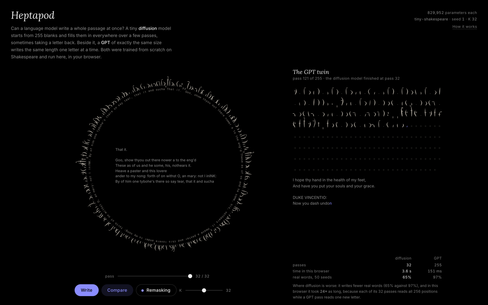

# Heptapod



Can a language model write a whole passage at once? A tiny **diffusion** language model starts from 255 blanks and fills them in everywhere over a few passes, drawing each letter as a brush stroke around a circle, and sometimes taking a letter back. Beside it, a **GPT** of exactly the same size, trained on the same text in the same way, writes the same length one letter at a time. Both were trained from scratch on tiny-shakespeare and run live in the browser in plain JavaScript.

## Why heptapods

In Ted Chiang's novella "Story of Your Life" (1998), filmed as *Arrival* (2016), the heptapods have two languages: Heptapod A, spoken one sound after another, and Heptapod B, written as whole sentences drawn at once on a surface, with no order. To draw a sentence that way, a writer must know how it ends before the first stroke.

A GPT writes like Heptapod A, one letter at a time, seeing only what came before. A masked diffusion model looks like Heptapod B: every position fills in together. The difference this page makes visible is that the diffusion model does not know the ending in advance. Letters committed in the same pass cannot see each other, which is why it needs many passes and sometimes takes letters back.

The film's premise, that learning a language rewires how you think, is the strong form of the Sapir–Whorf hypothesis. Its own linguistics consultant, Jessica Coon, rejects that idea for human languages. The page borrows the image, not the claim.

## Open it

**Live:** [joezgao.github.io/heptapod/](https://joezgao.github.io/heptapod/) (nothing to install).

The piece is two files that must sit side by side: `index.html`, the page (61,682 bytes; 20,323 with `gzip -6`), and `weights.js`, both models' int8 weights (2,284,308 bytes; 1,709,111 with `gzip -6`), which loads after the page has painted. It needs an internet connection only for two fonts. If your browser blocks local files:

```bash
python3 -m http.server 8000   # then open http://localhost:8000/
```

- **Write** starts a new passage with a new seed. On arrival it writes once with seed 1.
- The **pass** scrubber steps through the diffusion run; <kbd>←</kbd> <kbd>→</kbd> do the same.
- **K** sets the number of passes (8, 16, 32, 64, 128). Fewer passes commit more letters per pass, decided without seeing each other.
- **Remasking** on or off: with it on, a few of the least confident letters go back to blank in the middle of the run and are written again.
- **Compare** replays the diffusion run beside the GPT writing the same number of letters (255), one network pass per tick.
- **How it works** (top right) explains the method and the numbers; × or <kbd>Esc</kbd> closes it.
- `prefers-reduced-motion`: no stroke animation; each run jumps to the finished circle, with the scrubber.

## The models

| | diffusion | GPT twin |
|---|---|---|
| network | 4 pre-LayerNorm blocks (self-attention + 4× tanh-GELU MLP), 4 heads, 128 wide, learned token and position embeddings, output tied to the token embedding | the same |
| attention | both ways | causal |
| trained to | fill in blanks: a random share t ~ U(0,1) of each passage is masked; cross-entropy on the masked letters, weighted 1/t (the ELBO of absorbing-state masked diffusion) | predict the next letter |
| context, vocabulary | 256 letters; 65 characters + a blank | the same (the blank is never used) |
| parameters | **829,952** | **829,952** |
| validation loss, nats per letter (int8 weights, 400 validation windows) | ≈ 1.934, an estimate of an upper bound (the ELBO) | 1.452 |
| best checkpoint | step 19,750 of 20,000 (near-flat at the end) | step 13,000 of 20,000 (no better after; training loss kept falling) |
| training time, Apple M5 Pro, PyTorch 2.15 on MPS | 19 min | 20 min |

Same data (tiny-shakespeare, 1,115,394 characters, as printed by `train/prepare.py` with the file's sha256; split 90/10 in `train/train.py`), same recipe (the constants at the top of `train/train.py`): AdamW (β 0.9, 0.99, weight decay 0.1 on matrices), lr 2e-3 with a 300-step warmup and cosine decay to 1e-4, batch 64 × 256, dropout 0.1, gradient clipping at 1.0, best validation checkpoint kept; 20,000 steps (the command-line argument; `steps` in `train/logs/*.json`). Rounding to int8 (one scale per row) changed the validation loss by +0.0005 (diffusion) and +0.0001 (GPT).

**Writing.** Both start after the same given line break and write 255 letters at temperature 0.8.
- The diffusion model runs K passes over all 256 positions. Each pass draws a letter for every blank and keeps a random set of them, so that round(255·s/K) are written after pass s (random order, as in MDLM's sampler). With remasking on, during the middle half of the run a quarter as many of the least confident earlier letters (confidence as it was when they were written) go back to blank each pass, after ReMDM's confidence-based remasking.
- Keeping the most confident letters instead (LLaDA's order) was tried first. It made this small model write "you you you you" around the whole ring: 87% real words but only 29% distinct words at K 32 (8 seeds, remasking on). Random order is what the page ships.
- The GPT runs one pass per letter with a key/value cache.

## Results

**JS against PyTorch** (`node tests/probes.mjs`, 20 fixed probes per model, the same int8 weights): the largest logit difference is 1.9e-5 for the diffusion model and 1.5e-5 for the GPT, with the same top letter at all 5,120 positions in each. The GPT's cached one-letter-at-a-time forward matches its full forward exactly.

**Real words** (`node tests/wordrate_all.mjs 50`): the share of written words (runs of letters, inner apostrophes allowed, lower-cased) that occur anywhere in tiny-shakespeare, over seeds 1–50, run with `src/model.js` and the shipped weights in Node. Every sample is in `tests/wordrate-samples.json`.

| K (passes) | 8 | 16 | 32 | 64 | 128 |
|---|---|---|---|---|---|
| diffusion, remasking on | 52.9% | 60.1% | 65.1% | 67.8% | 73.0% |
| diffusion, remasking off | 51.3% | 55.7% | 60.6% | 60.1% | 61.7% |
| distinct words per sample (on / off) | 0.90 / 0.91 | 0.87 / 0.91 | 0.85 / 0.87 | 0.84 / 0.89 | 0.79 / 0.87 |

The GPT: **97.2%** real words (2,382 of 2,451), 0.82 distinct. The distinct-word share is a check that neither model scores by repeating itself.

**Time.** The page measures each run's compute time live, in a background worker. In Node on the same machine (`node tests/timing.mjs`, saved as `docs/timing-2026-11-08.json`), seed 1 at K 32 took 3.39 s for the diffusion model, 106 ms per pass, and 154 ms for the GPT's 255 letters; one headless Chrome run read off the page gave about 3.6 s and 0.15 s [unverified: not saved]. Timings vary from run to run (the second audit measured 4.2 s and 158 ms in Node). One diffusion pass reads all 256 positions; a GPT pass reads one new letter. So on a CPU the GPT finishes first. The page says so and claims no other speed.

**Page checks** (2026-11-09, after the weights moved into `weights.js`; Chrome 157 headless on the M5 Pro, served gzipped from localhost; every Lighthouse report is saved in `docs/lighthouse/` and records its Lighthouse and Chrome versions):

| check | result |
|---|---|
| phone harness `tests/phone.mjs`, output saved as `docs/phone-2026-11-09.txt` (iPhone 13, iPhone SE, iPhone 13 landscape with safe-area insets, 375 × 812, 1440 × 900, reduced motion) | PASS: no horizontal scroll, Write on the first screen, How it works opens from a tap 11 px above its text and closes from a tap 15 px off the ×, Compare runs to the end, every control reachable by Tab with a visible ring, 0 console errors; reduced motion shows the finished circle, still |
| Lighthouse 13.6.0 desktop, simulated throttling (`docs/lighthouse/2026-11-09-desktop-simulated.json`) | Performance 100, Accessibility 100, Best Practices 100, SEO 100; first paint 0.2 s |
| Lighthouse 13.6.0 mobile, simulated throttling (`docs/lighthouse/2026-11-09-mobile-simulated.json`) | Performance 100, Accessibility 100, Best Practices 100, SEO 100; first paint 0.8 s |
| before the split (2026-11-08, Lighthouse 12.8.2, one 2.35 MB file: `docs/lighthouse/desktop-simulated.json`, `mobile-simulated.json`, `*-devtools.json`) | Performance 87 desktop / 57 mobile under simulated throttling (first paint 1.6 s / 9.2 s); 100 / 100 with devtools throttling |

On 2026-11-09 the weights moved out of the page into `weights.js`, which loads after the page has painted, and the page gained a `<main>` landmark (Lighthouse 13 checks for one). Under simulated throttling first paint went from 9.2 s to 0.8 s on mobile and from 1.6 s to 0.2 s on desktop, which fits the earlier reading that the simulation counted the whole 1.73 MB document before first paint. The bytes sent are about the same as before (the weights barely compress: `gzip -6` saves 7–8% on the raw int8 files, 827,648 → 771,240 and 759,550 bytes); only the order changed. The page itself is unchanged apart from where it reads the weights: the JS-vs-PyTorch probes and the phone harness pass on the split build.

## Limits

- Both models are under a million parameters with 256 letters of context: they get Shakespeare's shape (speaker names, line breaks, short words), not its sense. The diffusion model misspells far more.
- The same number of training steps is not the same as each model at its best: the GPT had stopped improving by step 13,000, while the diffusion model was still creeping down until near the end. Whether longer training would help it is not tested [unverified].
- Not checked: Safari and Firefox, the speed on a real phone, memory use.
- The page's "time in this browser" is compute time only, not the time the animation takes: live passes are shown at least 90 ms apart, and Compare replays both runs one pass per 60 ms tick.


## Where each number comes from

Every figure above can be checked against a file in this repository or re-run with one command.

| claim | evidence |
|---|---|
| 829,952 parameters each | `weights/stats.json` (`params`), counted by `train/export.py`; the hand count is in `docs/audit-2026-11-08.md` |
| validation losses, best steps | `weights/stats.json`; curves in `train/logs/*.tsv` |
| training times (19 and 20 min) | `train/logs/*.json` (`seconds`: 1116 and 1171, evaluation included) |
| device (Apple M5 Pro, PyTorch 2.15, MPS) | the machine the runs were made on; not written into the logs [unverified from the files alone] |
| int8 changes the loss by +0.0005 / +0.0001 | `weights/stats.json` (`val_fp32` against `val_int8`) |
| JS against PyTorch | `node tests/probes.mjs` (prints the VERDICT line) |
| real words, distinct words, the LLaDA-order result | `node tests/wordrate_all.mjs 50` → `weights/wordrate.json`, samples in `tests/wordrate-samples.json`; the LLaDA-order trial was a scratch run (8 seeds) not kept in the repo, re-run by the auditor with the same result |
| browser and Node times | `docs/timing-2026-11-08.json` (`node tests/timing.mjs`); the headless Chrome figures are one unsaved run |
| file sizes, weight bytes | `wc -c index.html weights.js`, `gzip -6 -c index.html \| wc -c`, `gzip -6 -c weights.js \| wc -c`, `gzip -6 -c weights/diffusion.q8 \| wc -c` |
| data size, split, training recipe | `train/prepare.py` (prints 1,115,394 bytes and the sha256), `train/train.py` (split, optimiser, schedule, batch, dropout, clipping, steps) |
| phone harness | `node tests/phone.mjs <url> [shots-dir]` (needs `puppeteer-core`); output in `docs/phone-2026-11-08.txt`, screenshots in `screenshots/` |
| Lighthouse scores, Chrome version | `docs/lighthouse/2026-11-09-*.json` (Lighthouse 13.6.0 CLI, Chrome 157, served gzipped from localhost, after the split); the 2026-11-08 single-file reports (Lighthouse 12.8.2) are kept beside them |
| paper titles, authors, venues | checked on arXiv (2406.07524, 2310.16834, 2502.09992, 2503.00307) in `docs/audit-2026-11-08.md` |

## In this repository

| path | what |
|---|---|
| `index.html` | the page (built) |
| `weights.js` | both models' int8 weights as base64, loaded after the page paints (built) |
| `src/index.src.html` | the page source |
| `src/model.js` | the forward pass and both samplers; the page's worker and the tests run this same file |
| `train/prepare.py` | downloads tiny-shakespeare and checks its sha256 |
| `train/model.py` | the transformer (one class; `causal` picks the twin) |
| `train/train.py` | trains `diffusion` or `gpt` with the same recipe |
| `train/export.py` | int8 quantisation, validation losses, the 20 probes per model |
| `train/logs/` | training curves (`*.tsv`) and summaries (`*.json`) |
| `weights/` | the shipped int8 weights and `stats.json`, `wordrate.json` |
| `tests/probes.mjs` | JS forward pass vs PyTorch on 20 fixed inputs per model |
| `tests/wordrate_all.mjs` | the real-word measure for every setting, seeds 1–50; `tests/wordrate-samples.json` keeps every sample |
| `tests/phone.mjs` | the family phone harness |
| `tests/timing.mjs` | one timed run of each model in Node |
| `build.py` | writes `weights.js`, and inlines `src/model.js` and the numbers into `index.html` |
| `docs/audit-2026-11-08.md` | the independent claims audits and the fixes they led to |
| `docs/lighthouse/` | the Lighthouse reports quoted above (2026-11-09 after the split, 2026-11-08 before) |
| `docs/phone-2026-11-08.txt`, `docs/timing-2026-11-08.json` | the saved phone-harness output and Node timing |
| `screenshots/` | desktop (finished, mid-run at pass 14, Compare, How it works), iPhone 13, iPhone 13 Compare, iPhone SE, landscape, reduced motion |

To rebuild from scratch:

```bash
uv venv .venv && uv pip install --python .venv/bin/python torch numpy
.venv/bin/python train/prepare.py
.venv/bin/python train/train.py gpt 20000
.venv/bin/python train/train.py diffusion 20000
.venv/bin/python train/export.py
node tests/probes.mjs
node tests/wordrate_all.mjs 50
.venv/bin/python build.py
```

A retrain is not guaranteed to match. On 2026-11-09 both models were retrained on the same machine with the committed code and seed (`train/train.py`, 20,000 steps each; best validation loss as logged by the script): the GPT reached 1.436 (the shipped run: 1.447), but the diffusion model reached 2.031 (the shipped run: 1.933), about 5% worse. Validation is deterministic here (same windows and masks; the last ten evaluations of each run vary by 0.004), so the gap is between runs, not noise. Possible causes are run-to-run nondeterminism on MPS or a difference between the code that produced the shipped run and the code committed afterwards [unverified: not isolated]. The shipped weights and every number above come from the original runs.

## Credits and license

Method: absorbing-state masked diffusion as in MDLM (Sahoo et al., NeurIPS 2024) and SEDD (Lou, Meng and Ermon, ICML 2024); confidence-ordered unmasking as in LLaDA (Nie et al., 2025); confidence-based remasking after ReMDM (Wang et al., 2025). GPT design after Karpathy's [nanoGPT](https://github.com/karpathy/nanoGPT) (MIT). The idea of a GPT twin that shares the diffusion model's code comes from nathanrs's [tiny-diffusion](https://github.com/nathanrs/tiny-diffusion) (MIT); its code was read, not copied. All code here was written for this piece. Training text: tiny-shakespeare from Karpathy's [char-rnn](https://github.com/karpathy/char-rnn) (Shakespeare, public domain). Fonts: Lora and Inter, SIL Open Font License. The brush glyphs are generated for this page and are not taken from any film.

Code: MIT. See [LICENSE](LICENSE).

Built with Claude for Joe Gao.
